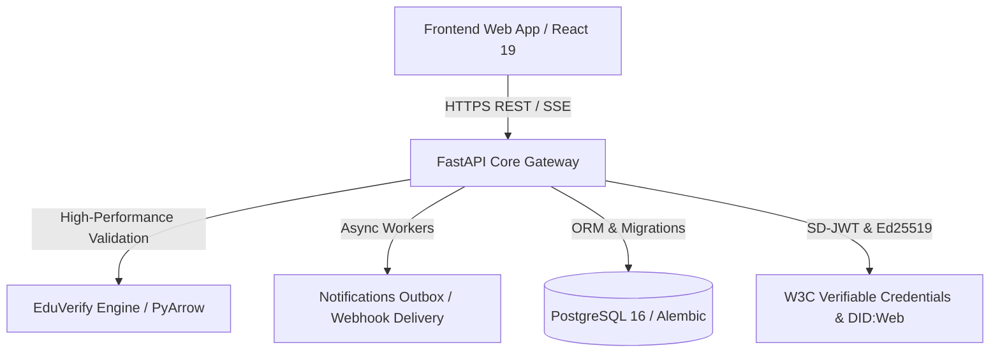

# EduVerify: Trust & Verification Infrastructure for Higher Education

**EduVerify** is an enterprise-grade, high-performance central repository and cryptographic verification trust layer for AICTE-approved higher education institutions, keyed by the Automated Permanent Academic Account Registry (APAAR) ID.

Designed under the **DPDP Act 2023** and **W3C Verifiable Credentials** standards, EduVerify prevents ghost student fraud, enforces sanctioned intake quotas, audits cross-institutional duplicate enrolments, and issues W3C/SD-JWT verifiable educational credentials.

---

## 🚀 Live Hosted Demo & Endpoints

| Service / Interface | Environment | URL | Status Check |
| :--- | :--- | :--- | :--- |
| **API Healthcheck** | Production (Render) | [https://eduverify-api.onrender.com/healthz](https://eduverify-api.onrender.com/healthz) | `curl -s https://eduverify-api.onrender.com/healthz` |
| **Interactive OpenAPI Docs** | Production (Render) | [https://eduverify-api.onrender.com/docs](https://eduverify-api.onrender.com/docs) | Swagger UI / ReDoc |
| **Frontend Web Application** | Production (Render) | [https://eduverify-web.onrender.com](https://eduverify-web.onrender.com) | React 19 + Vite |
| **Decentralized Identifier (DID)** | Production (Render) | [https://eduverify-api.onrender.com/.well-known/did.json](https://eduverify-api.onrender.com/.well-known/did.json) | W3C `did:web` Root Document |
| **Local API Service** | Local Development | `http://localhost:8000/healthz` | `uvicorn app.main:app` |

---

## 🏗️ Architecture & Features



1. **High-Performance Ingestion & Engine**: Processes 20,000+ student records in under 30 seconds on free tier memory limits (< 400 MB RSS) using vectorized columnar validation.
2. **Database Performance Indexing**: Optimized composite indexes on `(institution_aicte_id, academic_year)`, `(rule_id, priority)`, `(batch_id, status)`, and `apaar_hash`.
3. **DPDP Act 2023 Privacy & Audit Ledger**: SHA-256 chained hash ledger with purpose-bound consent enforcement, audit logging, and Fernet PII encryption at rest.
4. **Verifiable Credentials (W3C / SD-JWT)**: Selective disclosure credentials signed with Ed25519, verifiable via public W3C `did:web` discovery and dynamic revocation status lists.
5. **Contract-First Zero-Drift**: Verified 100% path synchronization between `contracts/openapi.yaml` and live FastAPI application routes via Schemathesis and openapi-spec-validator.
6. **Security Hardening**:
   - `bandit` clean (0 security alerts).
   - `pip-audit` clean (0 known dependency vulnerabilities).
   - Strict rate limits on `/v1/auth/login` (10/min) and `/v1/verify` (60/min).
   - 15 MB payload guard (`RequestSizeLimitMiddleware`).
   - Automated HTTPS redirect and HSTS outside local development.
   - Reviewed OWASP ZAP baseline scan suite (`infra/zap/`).

---

## 🛠️ Deploy to Render via Blueprint

EduVerify is configured for continuous deployment using the unified Blueprint file `render.yaml`.

### 1. Blueprint Structure
The blueprint defines:
- `eduverify-api`: Python 3.11 web service with automatic Alembic migrations and demo data seeding.
- `eduverify-web`: Vite static site with single-page application routing.
- `eduverify-db`: PostgreSQL 16 database.
- `envVarGroups`: Modular environment groups (`eduverify-dev-env`, `eduverify-staging-env`, `eduverify-prod-env`) providing automatic `PUBLIC_BASE_URL` and `FRONTEND_URL` bindings.

### 2. Deployment Steps
1. Fork or clone this repository to GitHub.
2. Log in to the [Render Dashboard](https://dashboard.render.com/).
3. Click **New +** -> **Blueprint**.
4. Connect your GitHub repository and branch (`main` for production, `staging` for pre-release).
5. Render will automatically configure services, create the PostgreSQL instance, apply Alembic migrations, and seed demo credentials.

### 3. Run Automated Smoke Test
Verify the deployment end-to-end:
```bash
./infra/smoke.sh https://eduverify-api.onrender.com
```
The smoke test validates:
- [x] `/healthz` system and database connectivity.
- [x] `/v1/auth/login` JWT acquisition for demo administrators.
- [x] `/v1/batches` ingestion and validation pipeline.
- [x] `/v1/verify/nonce` and W3C `did:web` root discovery.

---

## 💾 Backups and Disaster Recovery

> [!WARNING]
> Render free tier PostgreSQL instances expire after 30 days. Regular automated backups to external S3-compatible object storage are mandatory.

- **Automated Backup**: `./infra/backup.sh` (dumps schema/data with gzip compression and SHA-256 signatures).
- **Restore Drill**: `./infra/restore.sh <backup-file.sql.gz> --force`.
- **Documentation**: See [infra/BACKUPS.md](file:///c:/Users/Vedant/Documents/Coding/Projects/EDUVERIFY/infra/BACKUPS.md).

---

## 🧪 Local Development & Testing

```bash
# 1. Setup virtual environment and dependencies
python -m venv .venv
source .venv/bin/activate  # Or .\.venv\Scripts\Activate.ps1 on Windows
pip install -r backend/requirements.txt
pip install -e ./engine

# 2. Run database migrations and seed data
cd backend
alembic upgrade head
python -m app.seed --if-empty

# 3. Start local development API server
uvicorn app.main:app --reload --port 8000
```

### Running Test Suites
```bash
# Run full backend test suite
pytest backend/tests/

# Run Schemathesis OpenAPI contract compliance tests
pytest backend/tests/test_contract.py

# Run database migration upgrade/downgrade roundtrip tests
pytest backend/tests/test_migration_and_seed.py

# Security static analysis
bandit -r backend engine -s B101,B104

# Vulnerability scan
pip-audit
```
