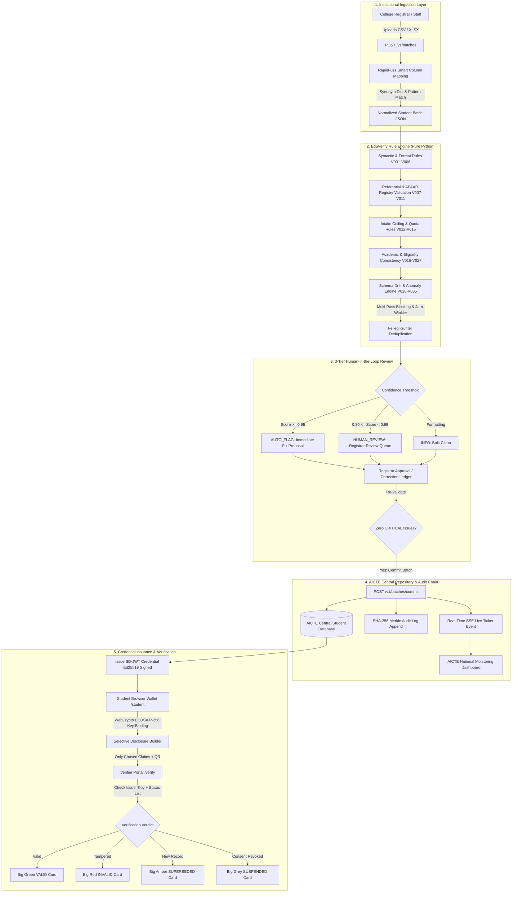
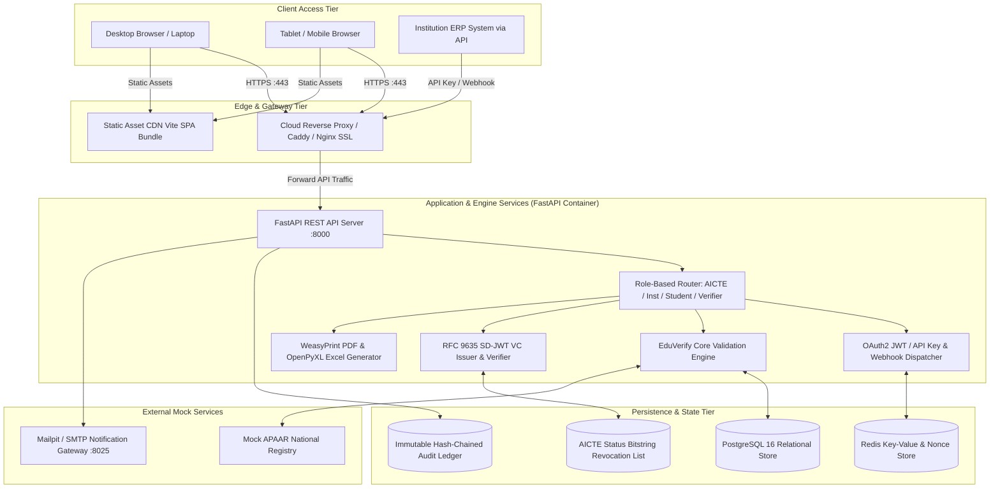

# EduVerify System Architecture & Technical Specifications

> **System Version:** `1.0.0` | **Date:** 2026-10-24  
> **Target:** AICTE Approval & Enrollment Data Quality Verification Platform  
> **Security Baseline:** DPDP Act 2023 · ISO/IEC 27001 · W3C Verifiable Credentials · IETF RFC 9635 SD-JWT

---

## 1. Architectural Philosophy & Design Principles

EduVerify is architected to address national higher education data verification at population scale. It adheres to four fundamental design principles:

1. **Privacy-by-Design & Data Minimization:** Personal Identifiable Information (PII) like APAAR ID, email, and mobile are cryptographically masked (`1234****9012`) across all API responses, logs, and public dashboards. Unmasked data is accessible exclusively to authorized institutional registrars and students inspecting their own records.
2. **Statutory & Regulatory Alignment:** Every validation rule is mapped directly to AICTE Approval Process Handbook (APH) regulations, National Education Policy (NEP 2020) APAAR guidelines, and the Digital Personal Data Protection (DPDP) Act 2023.
3. **Deterministic Governance with Explainable Human-in-the-Loop:** Automated checks provide exact rule IDs (`V001–V035`), regulatory rationales, and deterministic suggested fixes. Suspicious cases are routed to human review queues based on confidence thresholds rather than arbitrary automated rejections.
4. **Zero-Gas Cost Cryptographic Trust:** Instead of costly public blockchain networks, EduVerify utilizes **Ed25519 digital signatures, IETF RFC 9635 SD-JWTs with client-side WebCrypto key binding, and an immutable SHA-256 hash-chained audit ledger**—achieving sub-second verification latency, zero per-transaction fees, and a cloud memory footprint below 350 MB RSS.

---

## 2. End-to-End Data Processing Pipeline

The following Mermaid diagram illustrates the lifecycle of educational enrollment data from institutional file ingestion through 35-rule validation, anomaly detection, human review, central repository commitment, and verifiable credential issuance:

---

## 3. Cloud Deployment Topology & Infrastructure Architecture

The deployment architecture utilizes a lightweight, horizontally scalable micro-monolith topology designed to operate reliably within strict memory and compute ceilings:

---

## 4. Architectural Component Breakdown

### 4.1. Ingestion & Pre-Processing Tier
- **Smart Column Mapping (`column_synonyms.yaml` + RapidFuzz):** Uses token sort and Levenshtein ratio comparisons against standard AICTE canonical field names. Institutions can save mapping profiles to remember custom college ERP headers (`PRN → institution_student_id`, `DOB → dob`).
- **Stream Ingestion & Parsing:** Pure-Python chunked readers support `.csv`, `.xlsx`, and `.parquet` inputs with immediate schema typing and date format normalization.

### 4.2. EduVerify Pure Python Validation Engine
- **35 Deterministic Rules (`V001–V035`):**
  - *Syntactic & Identity (`V001–V006`):* Verhoeff check on APAAR, ISO-8601 DOB validity, gender enumerated sets.
  - *Referential Integrity (`V007–V011`):* Cross-table foreign key constraints, active national APAAR duplicates.
  - *Intake & Quota (`V012–V015`):* Program approved intake ceilings, supernumerary caps (TFW $\le 5\%$, PMSSS, JK, NE), NRI/OCI/FN legal quotas.
  - *Academic Sanity (`V016–V027`):* Year of study vs course duration, graduation year consistency, excel date mangling recovery (`V023`).
  - *Schema Drift & Distribution (`V028–V035`):* Unseen categorical levels, column deletions, and statistical z-score shifts.
- **Deduplication Engine:** Multi-pass deterministic blocking followed by phonetic Metaphone clustering and weighted demographic Jaro-Winkler comparison.

### 4.3. Cryptographic Trust & Verifiable Credentials
- **RFC 9635 SD-JWT Core:** Educational verifiable credentials issued with Ed25519 digital signatures. Selective disclosure hashes (`_sd`) conceal undisclosed claims while proving the authenticity of selected fields.
- **WebCrypto Holder Key Custody:** Student browser generates an `ECDSA P-256` key pair with `extractable: false` stored in IndexedDB. Key Binding JWT (`KB-JWT`) signed by this device key prevents token replay attacks.
- **Bitstring Status List:** Real-time bit-indexed revocation list tracking credential validity (`ACTIVE`, `SUSPENDED`, `SUPERSEDED`, `REVOKED`) without leaking student identity.

### 4.4. Security, RBAC & Audit Chain
- **Role-Based Access Control (RBAC):** 7 distinct actors with strict route protection:
  - `AICTE_ADMIN`, `AICTE_ANALYST`, `INSTITUTION_ADMIN`, `INSTITUTION_STAFF`, `DAB_ADMIN`, `STUDENT`, `VERIFIER`.
- **SHA-256 Hash-Chained Audit Ledger:** Every critical event (batch commit, fix approval, status transition, consent withdrawal) appends a cryptographically chained block (`prev_hash + payload_hash → current_hash`). The UI includes an **"Audit Chain Intact ✓"** indicator verified live via `GET /v1/audit/verify-chain`.

---

## 5. Security & Privacy Guarantees

1. **Zero Raw PII Transmission:** Verifiers never receive unselected student attributes. Database columns storing student identifiers utilize SHA-256 masked hashes for indexing.
2. **DPDP Act 2023 Statutory Compliance:** Purpose-bound consent switches (`REPOSITORY`, `VERIFICATION_SHARE`, `ANALYTICS_AGGREGATE`) allow instant revocation, triggering immediate credential suspension.
3. **No Private Key Extraction:** WebCrypto hardware-isolated browser keys cannot be exfiltrated via client-side scripts, protecting student credentials even in hostile browser environments.
