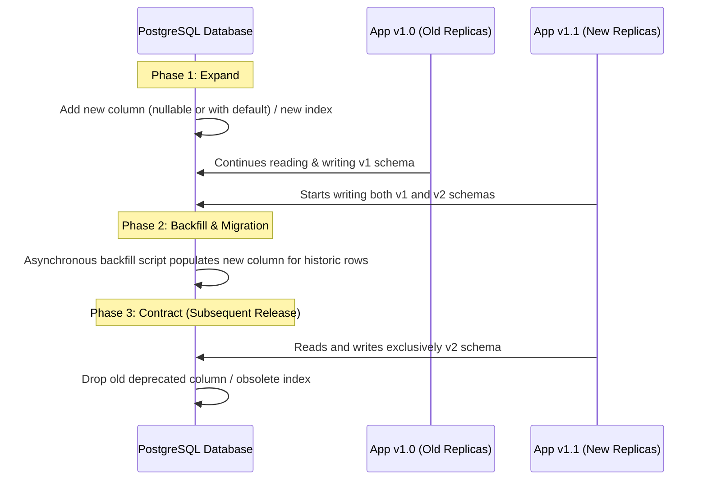

# Database Migration Strategy: Expand / Contract Architecture

This document outlines the database schema migration methodology for EduVerify. It governs all database evolutions across development, staging, and production environments, ensuring zero-downtime deployments, full backwards compatibility, and verified rollback safety.

---

## 1. Core Principles

1. **Zero-Downtime Deployments**: Database migrations run before or during application rolling restarts. The database must remain fully compatible with both the previous version (N-1) and the new version (N) of the application code simultaneously.
2. **Never Destructive in One Deploy**: Renaming columns, dropping tables, removing constraints, or altering column types destructively in a single deployment is strictly prohibited.
3. **Mandatory Downgrade Testing**: Every Alembic migration script **must** implement both `upgrade()` and `downgrade()` functions. Automated tests continuously assert that `upgrade -> downgrade -> upgrade` completes without error.

---

## 2. The Expand / Contract Migration Pattern

All schema modifications follow a structured multi-phase lifecycle:



### Phase 1: Expand (Release N)
- **Adding Columns**: New columns must be either `nullable=True` or specify a server-level default (`server_default=...`).
- **Adding Tables**: New tables can be added freely. Foreign keys referencing existing tables must allow referential integrity without blocking existing writes.
- **Adding Indexes**: Created with `if_exists=False` / `postgresql_concurrently=True` in production to prevent blocking concurrent transactional table locks.

### Phase 2: Dual Write & Backfill
- Application code writes to both old and new representations.
- Read operations prefer the new representation with an automatic fallback to the old representation.
- A background backfill task or batch migration script migrates historic records in controlled chunked transactions.

### Phase 3: Contract (Release N+1)
- Once all running instances are updated to the new code and historic data is backfilled, a subsequent release drops the deprecated column or index.
- Because the old code is no longer running anywhere, dropping the column is non-breaking.

---

## 3. Alembic Standards and Guidelines

### Naming & Revision Structure
EduVerify Alembic revisions use four-digit zero-padded prefixes with descriptive snake_case names:
- `backend/alembic/versions/0001_initial_users.py`
- `backend/alembic/versions/0002_core_data_model.py`
- `backend/alembic/versions/0003_performance_indexes.py`

### Safe Index Creation & Dropping
To avoid `OperationalError: index already exists` during SQLite tests and table rebuilds:
- If a column is defined with `mapped_column(..., index=True)` in SQLAlchemy models, do not duplicate it as an explicit `Index(...)` inside `__table_args__`.
- Composite indexes (e.g. `(institution_aicte_id, academic_year)`) belong in `__table_args__`.
- Downgrades must cleanly remove all indexes created in the upgrade:
```python
def downgrade() -> None:
    op.drop_index("ix_issues_rule_priority", table_name="issues")
    op.drop_index("ix_batches_inst_year", table_name="batches")
    op.drop_index("ix_student_records_inst_year", table_name="student_records")
```

---

## 4. Automated Migration & Downgrade Verification

EduVerify includes automated tests validating Alembic migrations in `backend/tests/test_migration_and_seed.py`:

```bash
# Run migration upgrade and downgrade cycle test
pytest backend/tests/test_migration_and_seed.py
```

The test executes:
1. `alembic upgrade head`: Applies all schema migrations from base to current head.
2. `python -m app.seed --if-empty`: Seeds demo institutions, users, rules, and student batches.
3. `alembic downgrade -1`: Verifies that rolling back the latest revision leaves the schema in a coherent state.
4. `alembic upgrade head`: Verifies that re-applying the migration cleanly restores head without orphaned locks or schema drifts.

---

## 5. Rollback Emergency Runbook

If a deployment must be rolled back in production:

1. **Roll back application deployment**:
   Revert the web service to the previous deployment revision on Render / Kubernetes.
2. **Determine current revision**:
   ```bash
   cd backend
   alembic current
   ```
3. **Downgrade schema if necessary**:
   ```bash
   alembic downgrade -1
   ```
4. **Verify database status & health**:
   ```bash
   curl -s https://eduverify-api.onrender.com/healthz
   ```
